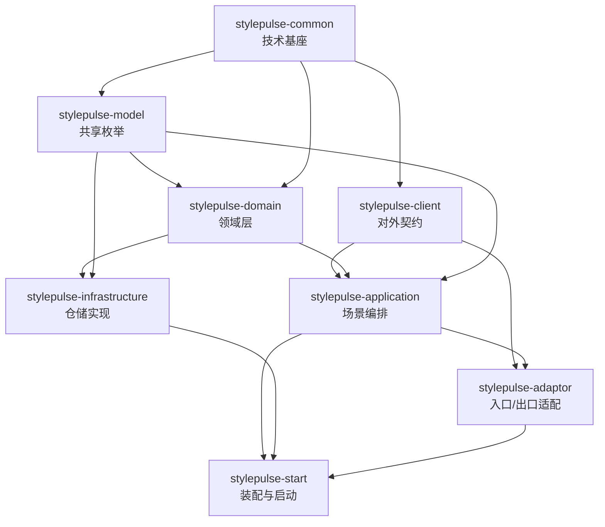

# StylePulse · SHEIN 供货商侧返单决策中台

> 一个**按 DDD 六层架构落地的完整 Java 工程**：从销量事件进来，到生产指令下发给工厂，中间四个技术难点（倒排索引、滑动窗口、三层幂等、Lua 原子预占）全部有可运行代码和测试。

业务方案见 [docs/01-business-case.md](docs/01-business-case.md)，技术设计见 [docs/02-technical-design.md](docs/02-technical-design.md)，代码规范见 [AGENTS.md](AGENTS.md)，面试话术见 [docs/03-interview-playbook.md](docs/03-interview-playbook.md)。

---

## 1. 解决什么问题

SHEIN 用"小单快反"供货：新品首单 100–200 件测款，卖得好要在几天内追单，库存周转压到 36 天左右。供货商的日常就是：

> 首单开卖 → 数据跑 3~5 天 → 判断追不追、追多少、拆到哪个尺码、哪个工厂产得出来 → 下发工厂 → 货到仓 → 复盘

这条链上每一步靠人拉 Excel，慢了断货、追多了压库存。本工程就是把这条链做成系统，并且**只做这条链**。

| 痛点 | 代码里的解法 | 看哪里 |
|---|---|---|
| 款多到看不完，逐款遍历算不动 | 规则倒排索引 + RoaringBitmap 交集 | [ReplenishRuleIndex](app/stylepulse-infrastructure/src/main/java/com/stylepulse/infrastructure/replenish/index/ReplenishRuleIndex.java) |
| 销量事件重复、乱序，窗口算不准 | 5 分钟分桶 + eventId 去重 + eventTime 水位线 | [SalesWatermarkDomainServiceImpl](app/stylepulse-domain/src/main/java/com/stylepulse/domain/metric/service/SalesWatermarkDomainServiceImpl.java) |
| 巡检/事件/人工三路并发，重复追单 | 分布式锁 → 状态机 CAS → 唯一键 | [ReplenishDomainServiceImpl](app/stylepulse-domain/src/main/java/com/stylepulse/domain/replenish/service/ReplenishDomainServiceImpl.java) |
| 多个爆款抢同一产线，Excel 排产必超占 | Redis Lua 原子预占 + 三态 + 看板对账 | [CapacityRepositoryImpl](app/stylepulse-infrastructure/src/main/java/com/stylepulse/infrastructure/capacity/repository/CapacityRepositoryImpl.java) |
| 追单总量拆到尺码后，总额对不上 | 最大余额法 + MOQ 收敛 | [SizeAllocationDomainServiceImpl](app/stylepulse-domain/src/main/java/com/stylepulse/domain/replenish/service/SizeAllocationDomainServiceImpl.java) |

---

## 2. 快速开始

### 2.1 前置

- JDK 17+（本地验证用 21）
- Maven 3.9+
- Redis 7+（本地起一个即可，H2 不需要装）

```bash
# 起 Redis（任选其一）
redis-server --port 6379
# 或 docker run -d -p 6379:6379 redis:7
```

### 2.2 构建与启动

```bash
mvn clean package -DskipTests
java -jar stylepulse-start/target/stylepulse-start-1.0.0-SNAPSHOT.jar
```

> 如果你的 `~/.m2/settings.xml` 配了 http 镜像，Maven 3.9 会以 `Blocked mirror` 拒绝。
> 加一个只走 https central 的 settings 文件即可：`mvn -s <配置文件> clean package`。

启动后：接口 `8080`，H2 内存库自动建表并灌了 3 个款 + 3 条规则 + 6 个产能槽。

### 2.3 跑通一条完整链路

```bash
B=http://localhost:8080
NOW=$(($(date +%s)*1000))

# 1) 灌销量事件（合计 550 件）
for i in 1 2 3; do
  curl -s -X POST $B/api/events/sales -H 'Content-Type: application/json' \
    -d "{\"eventId\":\"demo-$i\",\"styleId\":1,\"qty\":150,\"eventTimeMillis\":$((NOW-i*10000))}"
done

# 2) 重复投递同一条事件 → 返回 accepted=false / DUPLICATED
curl -s -X POST $B/api/events/sales -H 'Content-Type: application/json' \
  -d "{\"eventId\":\"demo-3\",\"styleId\":1,\"qty\":150,\"eventTimeMillis\":$((NOW-5000))}"

# 3) 诊断：动销率 0.92、命中 RT-STD-002、建议追 660 件
curl -s -X POST $B/api/replenish/diagnose -H 'Content-Type: application/json' -d '{"styleId":1}'

# 4) 开决策单
curl -s -X POST $B/api/replenish/decisions -H 'Content-Type: application/json' \
  -d '{"styleId":1,"triggerSource":"MANUAL"}'

# 5) 再开一次 → duplicated=true，不会生成第二张单
curl -s -X POST $B/api/replenish/decisions -H 'Content-Type: application/json' \
  -d '{"styleId":1,"triggerSource":"SCHEDULE"}'

# 6) 审批 → 占产能 → 下发工厂 → 状态 DISPATCHED
curl -s -X POST $B/api/replenish/decisions/approve -H 'Content-Type: application/json' \
  -d '{"decisionId":1,"approved":true}'

# 7) 看 Redis 里的产能账：total=800, used=660
redis-cli HGETALL "cap:1:1:$(date -v+7d +%Y-%m-%d)"
```

**接口清单**

| 方法 | 路径 | 用途 | 模式 |
|---|---|---|---|
| GET | `/api/styles/{styleId}` | 款详情 | 读 |
| POST | `/api/events/sales` | 销量事件接入（MQ 的联调入口） | 写 |
| POST | `/api/replenish/diagnose` | 款诊断 | 规则+计算 |
| POST | `/api/replenish/decisions` | 开返单决策单 | 写 |
| POST | `/api/replenish/decisions/approve` | 审批并下发 | 写 |
| POST | `/api/capacity/reserve` | 产能预占 | 写 |
| POST | `/api/capacity/confirm` | 产能确认 | 写 |

---

## 3. 架构总览

### 3.1 模块依赖（Maven 强制约束）



| 模块 | 目录 | 职责 | 允许依赖 |
|---|---|---|---|
| `stylepulse-common` | `/stylepulse-common` | `ResultDO` / `Base*` / 异常 / 锁接口。六层之外的共享内核，**不含业务概念** | 无 |
| `stylepulse-model` | `/stylepulse-model` | 跨上下文共享的业务枚举与常量 | common |
| `stylepulse-client` | `/stylepulse-client` | RequestDTO / ResponseDTO / AppService 接口。**禁止依赖 model**（否则依赖扩散到外部系统） | common |
| `stylepulse-domain` | `/app/stylepulse-domain` | 聚合根、实体、值对象、Param、Result、DomainService、Repository 接口。**零技术依赖** | common、model |
| `stylepulse-application` | `/app/stylepulse-application` | 场景编排、Assembler、事务边界。实现 client 的接口 | common、model、client、domain |
| `stylepulse-infrastructure` | `/app/stylepulse-infrastructure` | 仓储实现：MyBatis-Plus / Redis / Lua / RoaringBitmap | common、model、domain |
| `stylepulse-adaptor` | `/app/stylepulse-adaptor` | input（Controller、MQ 消费者、定时任务）+ output（工厂接口） | common、model、client、application |
| `stylepulse-start` | `/stylepulse-start` | 唯一启动模块，负责组件扫描与配置 | 全部 |

**为什么这么分目录**：DDD 四层是"同一个可部署应用"的内部结构，放 `app/` 下集中表达；
`common` / `model` / `client` / `start` 是应用之外的东西（技术基座、对外契约、装配入口），
留在第一层与 `app/` 平级。目录结构本身就在回答"哪些是业务内核、哪些是外围设施"。

> 规则不是靠"自觉遵守"，而是靠 Maven 依赖图：`domain` 里根本拿不到 `RedisTemplate`，因为 pom 里没有。

### 3.2 一次"开返单决策"如何穿过六层

```
POST /api/replenish/decisions
  └─ ReplenishController                    [adaptor/input]     只做协议转换
      └─ ReplenishDecisionAppServiceImpl     [application]       场景编排：查款→诊断→拆量→开单→推进阶段
          ├─ StyleRepository.query           [domain 接口 / infra 实现]
          ├─ ReplenishDiagnosisSupport        [application]       复用单元：跨上下文取数 + 计算
          │   ├─ SalesWatermarkDomainService  [domain]            T2 分桶窗口
          │   ├─ StockHealthDomainService     [domain]            纯计算
          │   └─ ReplenishCalculateDomainService [domain]         规则+计算（T1 索引在仓储实现里）
          ├─ SizeAllocationDomainService      [domain]            纯计算：最大余额法 + MOQ
          ├─ ReplenishDomainService.openDecision [domain]         T3 三层幂等
          │   └─ ReplenishDecisionRepository  [domain 接口 / infra 实现：唯一键 + version CAS]
          └─ StyleDomainService.changeStage   [domain]            阶段流转（聚合根校验）
```

四层职责划分得很硬：

- **adaptor** 只认协议，不认识业务；
- **application** 只认流程，不认识公式；
- **domain** 只认规则，不认识 Redis；
- **infrastructure** 只认存储，不认识流程。

---

## 4. 四个技术难点在哪看

| # | 难点 | 主实现 | 关键设计 |
|---|---|---|---|
| **T1** | 规则命中不扫表 | [ReplenishRuleIndex](app/stylepulse-infrastructure/src/main/java/com/stylepulse/infrastructure/replenish/index/ReplenishRuleIndex.java) | 属性→规则的位图倒排，多维度 AND 交集粗筛；区间条件先桶化再精算。**桶化会多召回，但绝不漏** |
| **T2** | 滚动窗口水位 | [SalesWatermarkRepositoryImpl](app/stylepulse-infrastructure/src/main/java/com/stylepulse/infrastructure/metric/repository/SalesWatermarkRepositoryImpl.java) | `HASH` 存桶计数 + `ZSET` 定位窗口；`SETNX evt:{id}` 去重、`lastEventTime` 水位线治乱序。**先推水位再加计数**，宁可少算不多算 |
| **T3** | 重复追单幂等 | [ReplenishDomainServiceImpl](app/stylepulse-domain/src/main/java/com/stylepulse/domain/replenish/service/ReplenishDomainServiceImpl.java) + [ReplenishDecisionRepositoryImpl](app/stylepulse-infrastructure/src/main/java/com/stylepulse/infrastructure/replenish/repository/ReplenishDecisionRepositoryImpl.java) | 三层：分布式锁挡并发 / 状态机 CAS 挡非法流转 / `uk_style_round` 挡实现 bug |
| **T4** | 产能原子预占 | [CapacityRepositoryImpl](app/stylepulse-infrastructure/src/main/java/com/stylepulse/infrastructure/capacity/repository/CapacityRepositoryImpl.java) + [capacity_reserve.lua](app/stylepulse-infrastructure/src/main/resources/lua/capacity_reserve.lua) | Redis 当闸门、DB 当账本；Lua 内"读-判-写"原子；三态 + 超时回收 + 缓存未命中从 DB 重建 |

### 4.1 三个"为什么不用 X"

| 选择 | 常见替代方案 | 为什么不用 |
|---|---|---|
| 自建倒排索引 | Drools / Rete | 瓶颈在"款多"不在"规则多"，Rete 优化的是规则网络；而且规则要能版本化、灰度、复盘 |
| Redis Lua 预占 | `SELECT ... FOR UPDATE` | 产能槽是热点行，行锁打满连接池；Lua 只需要"读-判-写"原子，不需要事务 |
| 分桶窗口 | Flink 流计算 | 日事件百万级，单机够用；Flink 结果还要落存储再查一次，多一跳 |

---

## 5. 四种开发模式在代码里的落位

| 模式 | 场景 | 入口类 |
|---|---|---|
| **写** | 阶段流转、开单、审批、事件接入、产能预占 | `StyleDomainServiceImpl`、`ReplenishDomainServiceImpl`、`SalesWatermarkDomainServiceImpl`、`CapacityDomainServiceImpl` |
| **读** | 款详情 | `StyleQueryAppServiceImpl` |
| **规则+计算** | 规则匹配 + 追单量 | `ReplenishRuleAggregate` / `ReplenishCalculateDomainServiceImpl` |
| **纯计算** | 尺码拆量、健康度、影子对比 | `SizeAllocationDomainServiceImpl`、`StockHealthDomainServiceImpl`、`ShadowCompareDomainServiceImpl` |

**判断口诀**：会改状态 → 写；只查不改 → 读；有规则表 → 规则+计算；纯公式 → 纯计算。

---

## 6. 建议的代码阅读路线

按这个顺序读，大约 40 分钟能读完主干：

1. [AGENTS.md](AGENTS.md) —— 先建立"什么代码该放哪"的地图
2. `stylepulse-common/.../ResultDO.java` —— 全系统的返回口径
3. `app/stylepulse-domain/.../style/model/aggregate/StyleAggregate.java` —— 看聚合根如何守住状态机
4. `app/stylepulse-domain/.../replenish/model/entity/ReplenishRuleEntity.java` —— 看"规则+计算"怎么做到无副作用
5. `app/stylepulse-domain/.../replenish/service/SizeAllocationDomainServiceImpl.java` —— 看最大余额法怎么保证守恒
6. `app/stylepulse-infrastructure/.../replenish/index/ReplenishRuleIndex.java` —— T1
7. `app/stylepulse-infrastructure/.../metric/repository/SalesWatermarkRepositoryImpl.java` —— T2
8. `app/stylepulse-infrastructure/.../capacity/repository/CapacityRepositoryImpl.java` + Lua —— T4
9. `app/stylepulse-domain/.../replenish/service/ReplenishDomainServiceImpl.java` —— T3 三层幂等
10. `app/stylepulse-application/.../replenish/scenario/ReplenishDecisionAppServiceImpl.java` —— 看编排长什么样

---

## 7. 测试

```bash
mvn test        # 30 个用例：23 个领域单测 + 5 个索引单测 + 2 个端到端集成测试
```

| 测试 | 覆盖什么 |
|---|---|
| `SizeAllocationDomainServiceImplTest` | 总量守恒、断码加权、MOQ 收敛、曲线生效 |
| `ReplenishRuleAggregateTest` | 条件命中、公式方向、上限截断、MOQ 归零 |
| `StyleAggregateTest` | 合法/非法状态流转、终态保护 |
| `ReplenishDecisionAggregateTest` | 数量守恒不变量、影子单不可下发、版本递增 |
| `ReplenishRuleIndexTest` | 索引不漏、桶化多召回、停用规则不进索引 |
| `StylePulseEndToEndTest` | 全链路 + 10 路并发预占恰好 8 成功（需本机 Redis，没有则自动跳过） |

---

## 8. 已知边界（刻意留白）

| 项 | 现状 | 接生产要补什么 |
|---|---|---|
| 消息队列 | `SalesEventMessageConsumer` 用普通组件模拟 | 换成 `@RocketMQMessageListener`，方法体不用改 |
| 工厂接口 | `FactoryOrderAdaptorImpl` 打日志模拟 | 换成真实 HTTP + `Idempotency-Key: decisionId` |
| 数据库 | H2 内存库 | 换 MySQL 8 + ShardingSphere（配置层即可） |
| 产能路由 | 固定工厂 1 / 产线 1 | 按品类、历史质量分、报价做择优策略 |
| 巡检触发 | 只有人工与 HTTP 触发 | 加 `@Scheduled` 扫描活跃款，调 `openDecision` |
| 影子模式 | 领域服务已具备（`ShadowCompareDomainService`） | 加规则灰度开关与影子单落库 |

---

## 9. 与设计文档的对应关系

| 文档 | 对应内容 |
|---|---|
| [docs/01-business-case.md](docs/01-business-case.md) | 场景、五条痛点、七条主线、成果口径 |
| [docs/02-technical-design.md](docs/02-technical-design.md) | T1–T4 详细设计、数据模型、失败模式、DDD 落位表 |
| [AGENTS.md](AGENTS.md) | 分层依赖矩阵、命名规范、四种模式骨架、提交前自查 |
| [docs/03-interview-playbook.md](docs/03-interview-playbook.md) | 3 分钟叙事、12 条追问应答、简历表述 |