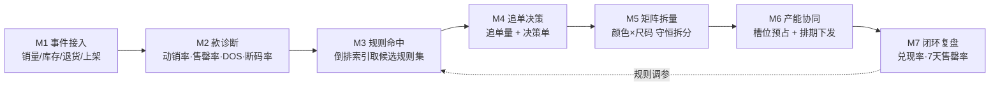

# Reflow · SHEIN 供货商侧「返单决策中台」业务方案

> 配套：[技术方案](02-technical-design.md) · [面试 Playbook](03-interview-playbook.md) · [DDD 规范](../AGENTS.md)

> 一句话：**在返单窗口关闭之前，把「追不追、追多少、追到哪个尺码、哪个工厂产得出来」这四个判断从人脑搬到系统里。**

| 项 | 内容 |
|---|---|
| 平台 | SHEIN（JIT / 小单快反的供货合作模式） |
| 身份 | 供货商侧自研系统，服务自己给 SHEIN 供的款 |
| 业务域 | 只做返单决策链，不做采购、定价、履约、财务 |
| 规模基线 | 千级在售款、万级 SKU、日事件百万级 |
| 技术形态 | Java 17 + Spring Boot 3 + MySQL 8 + Redis 7 + RocketMQ |

---

## 1. 业务背景：SHEIN 的供货机制决定了「返单」是生死线

SHEIN 的供应链不是"先预测再生产"，而是"先小批量测款、卖得好再快速追单"（小单快反 / 柔性供应链）。这套机制对供货商的要求可以压成三句话：

1. **首单必须小**：新品首单 100–200 件投线上测市场，每个 SKU 一般 100–200 件起订，不达预期即中止。
2. **追单必须快**：销售数据跑出来后，爆款要在 7–14 天内完成追单交付；公开资料里"销售向好 5 天内补单"是常态节奏。
3. **库存必须薄**：SHEIN 库存周转约 36–40 天、未售库存占比压到低个位数（对比 ZARA 约 80 天）。周转薄是它的成本优势来源，也意味着**供货商不能靠"多备一点"来对冲不确定性**。

三条叠加，供货商被夹在中间：

- 追慢了 → 断货断码，链接权重掉，销售峰值直接丢掉；
- 追多了 → 库存压在仓里，36 天的周转红线当场破掉，资金占用和清仓损失自己承担。

> 数据来源：[国海证券 SHEIN 供应链研报](https://bigdata-s3.wmcloud.com/researchreport/2023-12/b96ae82fbd711fd5cb1b89138bc4c168.pdf)（首单量、上新周期、库存周转、爆款率）、[小单快返能力分层拆解](https://www.eservicesgroup.com.cn/news/184064.html)（100–500 件起订、7 天打样、7–14 天追单交付、追单量公式）。抓取日期 2026-11-20，具体口径以当期公开资料为准。

---

## 2. 目标用户与现状

### 2.1 用户画像

给 SHEIN 供货的**中型供货商**，典型形态：

- 合作工厂 3–10 家，自己不做生产，负责款式、面辅料和排产协调；
- 在售款几百到几千，覆盖多个品类，每个款有颜色 × 尺码矩阵；
- 日常运营靠 2–5 个人 + Excel + 微信群，没有专职数据岗；
- 已经在用 ERP 管订单和库存，但 ERP 不管"要不要追单"。

### 2.2 现状做法与代价

| 环节 | 现状 | 代价 |
|---|---|---|
| 数据汇总 | 每天导一次销量表，人工拼 Excel | T+1 才看到数据，窗口已过去一半 |
| 判断追不追 | 运营凭经验看动销率、售罄率 | 标准不统一，同款不同人结论不同 |
| 算追多少 | 拍脑袋或按"上次追多少"复制 | 追多压货、追少断货，无法复盘 |
| 拆尺码 | 按总量平均分 | 断码的尺码没多分，卖得动的尺码反而缺 |
| 排产能 | 微信群问工厂"能不能做" | 多个款同时追抢同一产线，口头承诺必然超占 |
| 复盘 | 月底看库存 | 归因不到具体决策，下次照样错 |

---

## 3. 五条痛点

### P1 决策窗口只有几天，人工节奏跟不上

测款数据 3–5 天出结果，人工汇总要 T+1，评审会再排一天。等决策做完，追单窗口只剩一半，工厂插单还要 1–2 天。

**后果**：爆款断货，销售峰值丢失；等货到了热度已经过去。

### P2 款多到看不完，长尾款被系统性漏判

千级在售款 × 颜色尺码矩阵，逐款看动销率、售罄率、可售天数（DOS）、断码率、退货率，人力上限大概就是每天几十款。

**后果**：只有头部款被盯住，腰部款要么漏追（断货）要么没人管（滞销）。

### P3 追多追少都是错，且错法不对称

- 追多了：库存周转破 36 天红线，清仓打折吃掉利润；
- 追少了：断码断色，链接权重掉下去很难拉回来。

错一次要几周才能修正，这就是为什么运营倾向"保守追单"——保守的系统性代价是长期断货。

### P4 多入口并发判定同一个款，重复追单

触发返单判断的入口至少有三路：

1. 定时巡检（每小时/每天扫一遍）；
2. 事件触发（销量水位越过阈值）；
3. 人工催单（运营在群里@系统"这个款赶紧追"）。

三路同时打到同一个款，如果没有幂等控制，就会生成两张决策单、下两次生产指令。

**后果**：工厂重复生产，库存灾难，而且事后很难查是哪一路产生的。

### P5 产能是共享稀缺资源，Excel 排产必然超占

工厂产能按「工厂 × 产线 × 日期」切分，多个爆款同时追单要抢同一批槽位。微信群口头承诺没有账本，谁先谁后全靠人情。

**后果**：承诺了交不出来的单，交付延期，供应链信誉受损。

---

## 4. 方案：七条主线

系统只做一件事——**把返单决策链跑成闭环**，七个模块首尾相接。

| 模块 | 做什么 | 关键设计 | 对应痛点 |
|---|---|---|---|
| M1 事件接入 | 销量/库存/退货/上架事件幂等接入，多市场时区归一到业务日 | eventId 幂等 + eventTime 水位治乱序 | P1 P4 |
| M2 款诊断 | 计算动销率、售罄率、DOS、断码率、退货率，输出健康度评分 | 5 分钟桶滑动窗口，不扫原始明细 | P2 |
| M3 规则命中 | 从候选规则集里命中该款适用的返单规则 | **规则倒排索引 + Bitmap 交集**，不逐款遍历 | P2 |
| M4 追单决策 | 调用规则聚合根算追单量，生成决策单（自动/待审） | **状态机 CAS + 唯一键 + 本地消息表** 三重防重 | P4 |
| M5 矩阵拆量 | 款级总量拆到颜色×尺码，满足 MOQ 与总量守恒 | 尺码曲线加权 + 最大余额法 | P3 |
| M6 产能协同 | 按「工厂×产线×日期」原子预占产能，排期并下发 | **Redis Lua 原子预占 + 三态 + TTL 回收** | P5 |
| M7 闭环复盘 | 到仓兑现率、追单后 7 天售罄率回流，支撑规则调参 | 决策单与规则版本绑定，可归因 | P3 |

### 4.1 决策链路的一句话描述

> 销量事件进来 → 更新该款的水位 → 用倒排索引找到适用规则 → 规则聚合根算出追单量 → 开决策单（幂等）→ 拆到尺码 → 抢产能槽 → 下发工厂 → 货到仓后回填兑现率 → 复盘调参。

每一步都可独立验证，不依赖上下游"猜"。

### 4.2 为什么规则+计算模式适合这件事

返单规则天然是「条件 → 参数 → 公式」的三段结构：

- 条件：类目、价格带、上架天数、DOS 区间、售罄率区间；
- 参数：周期系数、增长系数、MOQ、追单上限倍数；
- 公式：`追单量 = 首单动销率 × 周期 × 增长系数`，再按上限倍数与 MOQ 收敛。

这正是 DDD 里「规则聚合根 + 匹配/计算方法」的标准形态：规则本身是聚合根，计算是无副作用的聚合根方法，规则可版本化、可灰度、可复盘。业务口径变了只改配置，不改代码。

---

## 5. 成果

成果分三类，**不混写、不编数**。

### 5.1 技术指标（可压测、可复现）

| 指标 | 口径 | 验证手段 |
|---|---|---|
| 单次全量诊断耗时 | 千级款跑完一轮诊断的 P99 | JMeter 灌入千级款 × 百万事件 |
| 规则命中候选集规模 | 单款命中候选规则数（越少越好） | 索引命中日志统计 |
| 水位误差率 | 实时滑窗结果 vs 离线批算结果的偏差 | 双跑比对 |
| 重复追单数 | 并发压测下同一款生成决策单的数量 | 三路并发触发压测，期望 0 |
| 产能超占数 | 并发预占下 `reserved > total` 的次数 | 并发预占压测，期望 0 |
| 降级可用性 | Redis 摘除后链路仍能出决策 | 故障注入 |

### 5.2 业务指标（只给口径与方向，数值由真实数据填）

| 指标 | 定义 | 预期方向 |
|---|---|---|
| 决策时效 | 事件发生 → 决策单生成 | T+1 → 分钟级 |
| 自动决策覆盖率 | 无需人工审核的决策单占比 | 随规则成熟度提升 |
| 断码率 | 有销量但某尺码连续 N 天零可售的款占比 | 下降 |
| 追单命中率 | 追单到仓后 7 天内售罄的比例 | 可量化、可对比规则版本 |
| 滞销占比 | 追单后 30 天未售出比例 | 不恶化或下降 |

> 这类指标必须用真实历史数据回放才有意义。文档只定义口径，不写具体数字——面试时给口径和验证方法，比报一个编出来的百分比可信得多。

### 5.3 平台事实（引用，不加工）

首单量、补单窗口、库存周转、上新量等，见第 1 节来源链接。

---

## 6. 边界：明确不做什么

| 不做 | 原因 |
|---|---|
| 选品/买手 | 这是商业判断，不是系统能替代的 |
| 采购下单与面辅料管理 | 属于 ERP 范畴，本系统只输出"建议追单量" |
| 定价与核价 | 不碰价格，只输出数量建议 |
| 履约与物流跟踪 | 只关心"货到仓"这个节点是否兑现 |
| 财务结算 | 不做账，不复核货款 |
| 全平台多平台 | 只服务 SHEIN 供货场景，不为通用化做抽象 |

**这条边界是刻意的**：正因为只做一件事，规则才能做到可配置、指标才能做到可归因。做成"又一个 ERP"就失去存在意义。

---

## 7. 与现有做法的差异

| 方案 | 能力 | 缺口 |
|---|---|---|
| Excel + 人工 | 灵活 | 时效 T+1、标准不统一、无法归因、并发必出错 |
| 通用 ERP 的补货模块 | 有库存和销量报表 | 规则是通用公式，不贴合 SHEIN 小单快反的窗口节奏；不做产能协同 |
| 通用补货算法（安全库存/ROP） | 稳态需求下有效 | 首单只有 100–200 件、生命周期按周计，稳态假设不成立 |
| **本系统** | 事件驱动 + 规则可配置 + 产能闭环 | 只适用于 SHEIN 供货场景（这是设计取舍，不是缺陷） |

---

## 8. 风险与假设

| 风险 | 应对 |
|---|---|
| 平台规则/合作模式变化 | 规则版本化、可配置，口径变化只改配置 |
| 历史数据不足，规则冷启动 | 先用保守参数 + 全量人工审核，影子模式积累对比数据后再放开自动决策 |
| 事件源不稳定（漏事件） | 日批对账兜底，差异告警 |
| 过度自动化导致误判 | 决策单保留人工复核开关，高风险款强制人工 |
| 产能承诺与实际不符 | 预占只是准入，到仓兑现率回填后反哺工厂评分 |

**核心假设**：供货商能拿到款的销量与库存数据（自有 ERP 或平台后台导出），且销量事件可近实时获得。若只能日批，M2/M3 降级为日频，决策时效从分钟级降到小时级，但不影响正确性。

---

## 9. 一句话总结（给面试用）

> 这不是"补货系统"，是**返单窗口内的决策闭环**：窗口只有几天、款有上千个、产能在抢，所以它必须同时解决"算得准"（规则+计算）和"扛得住"（索引、滑窗、幂等、原子预占）。缺任何一半，系统都只是在 Excel 上套了个壳。