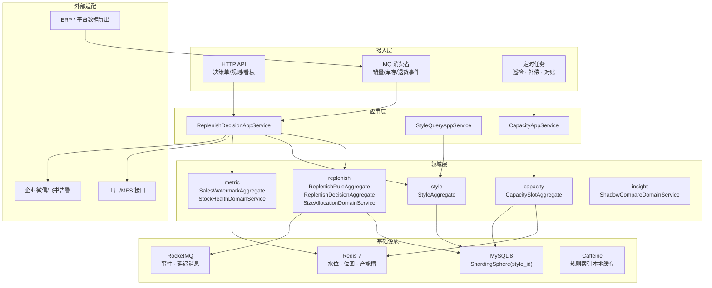
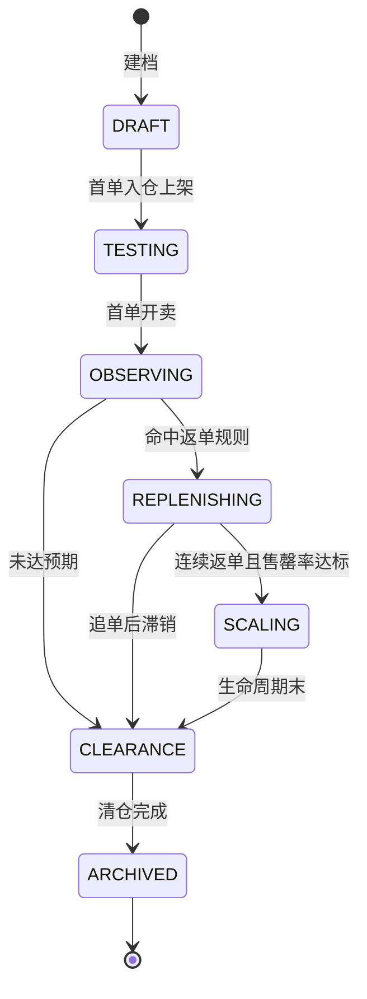
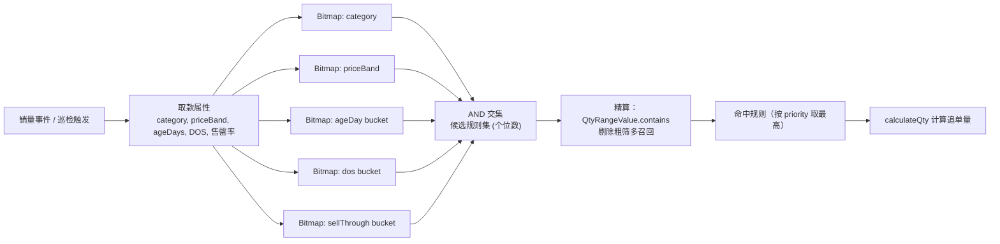
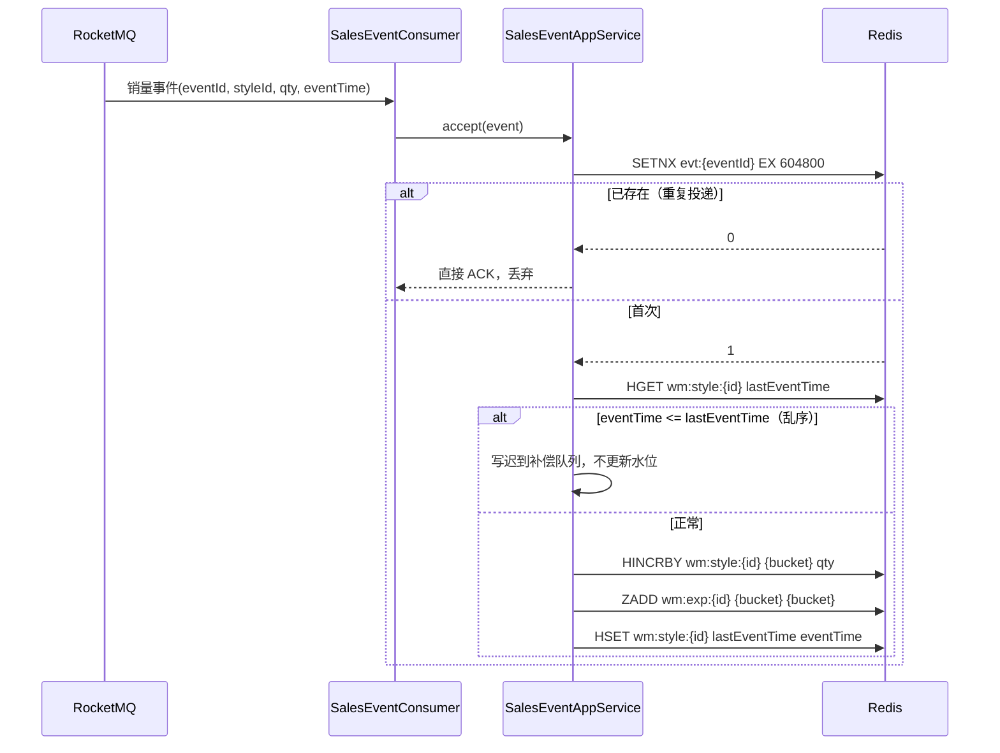
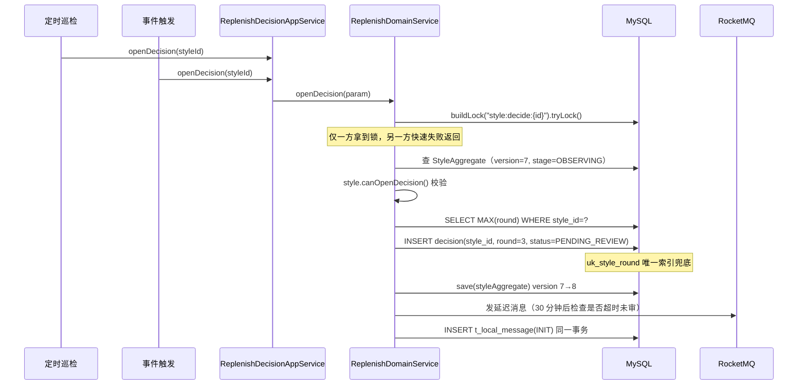
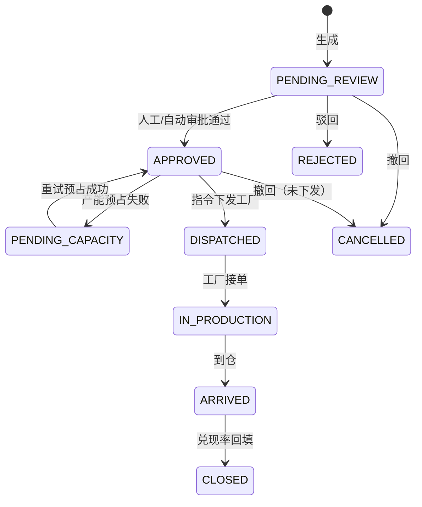
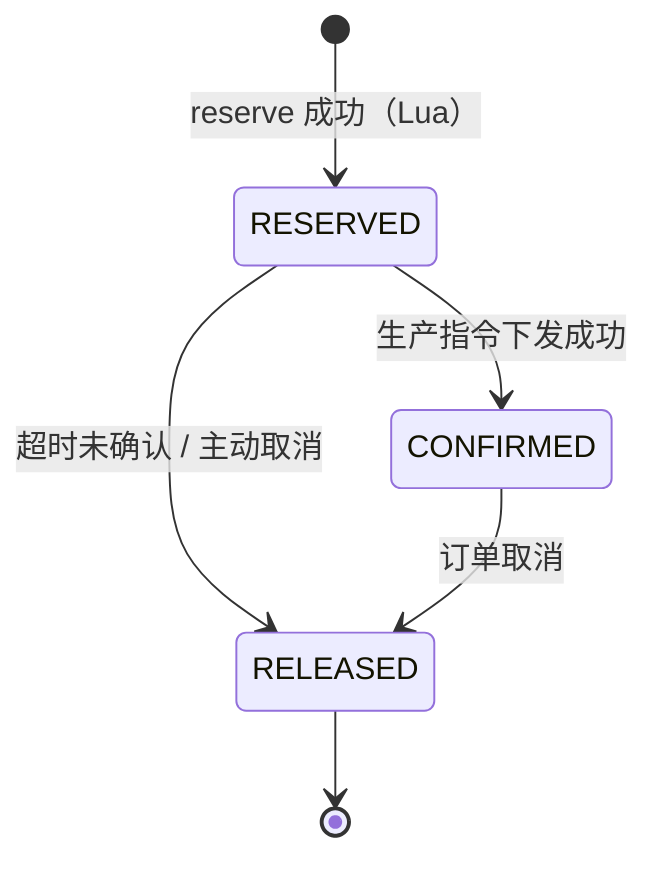

# Reflow 技术方案

> 配套文档：[业务方案](01-business-case.md) · [DDD 规范](../AGENTS.md) · [面试playbook](03-interview-playbook.md)

---

## 1. 总体架构

系统是**单体内聚 + 领域分模块**：五个限界上下文在一个 Spring Boot 应用内，通过领域接口解耦，为后续拆服务留好边界（不提前拆，千级款不需要微服务）。



### 1.1 五层依赖约束

| 层 | 可以依赖 | 绝对禁止 |
|---|---|---|
| `domain` | `model` | Spring 以外的中间件、HTTP 客户端、RoaringBitmap、Caffeine |
| `application` | `domain`、`client`、`model` | 中间件、其他上下文二方包、DB 直连 |
| `infrastructure` | `domain`、`model` | `application`、`client`、第三方 HTTP |
| `adaptor` | 实现 `application`/`domain` 定义的接口 | 反向被 domain 依赖 |
| `client` | 无（自包含） | `model`、`domain`、`application` |

**关键**：`RoaringBitmap`、`Caffeine`、`RedisTemplate` 全部落在 `infrastructure`；`domain` 只看到接口和值对象。

---

## 2. 限界上下文

| 上下文 | 聚合根 | 核心职责 | 主模式 |
|---|---|---|---|
| `style` | `StyleAggregate` | 款主数据、颜色尺码矩阵、生命周期状态机 | 写 |
| `metric` | `SalesWatermarkAggregate` | 销量事件、分桶滑窗、健康度指标 | 写 + 纯计算 |
| `replenish` | `ReplenishRuleAggregate`、`ReplenishDecisionAggregate` | 规则匹配、追单量、拆量、决策单 | **规则+计算** + 写 |
| `capacity` | `CapacitySlotAggregate` | 产能槽、预占/确认/释放、生产指令 | 写 |
| `insight` | 无（纯计算） | 兑现率、命中率、影子对比 | 纯计算 + 读 |

---

## 3. 领域模型

### 3.1 款生命周期



状态流转只允许通过 `StyleAggregate.changeStage(ChangeStageParam)`，方法内部校验 `StageEnum` 的合法前置状态，非法流转抛 `AggregateException`。

### 3.2 聚合根清单

| 聚合根 | 关键字段 | 关键方法 |
|---|---|---|
| `StyleAggregate` | `styleId, styleCode, categoryId, priceBand, launchDate, firstOrderQty, stage, version` | `changeStage`、`isReplenishable`、`canOpenDecision` |
| `SalesWatermarkAggregate` | `styleId, lastEventTime, version` | `acceptEvent`、`windowSales` |
| `ReplenishRuleAggregate` | `ruleId, priority, categoryIds, priceBands, ageDayRange, dosRange, sellThroughRange, cycleFactor, growthFactor, moq, maxMultiplier, ruleVersion, enabled` | `matchStyle`、`calculateQty` |
| `ReplenishDecisionAggregate` | `decisionId, styleId, round, ruleId, ruleVersion, totalQty, shadow, status, version` | `submitReview`、`approve`、`markDispatched`、`confirmArrived`、`cancel` |
| `CapacitySlotAggregate` | `factoryId, lineId, bizDate, totalQty, reservedQty, confirmedQty` | `reserve`、`confirm`、`release` |

### 3.3 实体与值对象

| 类型 | 名称 | 说明 |
|---|---|---|
| Entity | `SkuEntity` | 颜色×尺码成员，属性用 `Field<Integer>` 包一层 |
| Value | `SizeCurveValue` | 尺码→权重，方法 `weightOf(sizeCode)`、`normalizedWeights()` |
| Value | `BusinessDateValue` | 业务日，处理多市场时区归一，方法 `of(instant, zone)`、`isHoliday` |
| Value | `QtyRangeValue` | 区间值对象，方法 `contains(int)`、`overlaps(QtyRangeValue)` |
| Param | `MatchStyleParam` | 规则匹配入参 |
| Param | `CalculateQtyParam` | 追单量计算入参，含 `SizeCurveProvider` 懒加载接口 |
| Result | `CalculateQtyResult` | 追单量结果，充血方法 `isBelowMoq()` |

---

## 4. T1：规则倒排索引（不扫表）

### 4.1 问题定义

诊断一轮要做的事：对每个在售款，找出适用的返单规则并精算。

朴素做法 `for style in allStyles: for rule in allRules: if rule.match(style)`，复杂度 `O(N×M)`。千级款 × 几百条规则 = 数十万次属性比较，赛一个大促巡检就顶不住；扩到十万款直接不可行。

### 4.2 关键判断：瓶颈在"款多"，不在"规则多"

这是选型的分水岭，也是面试必被问的点。

| 维度 | 本项目 | 典型规则引擎场景 |
|---|---|---|
| 规则数量 | 几十到几百条 | 几千到上万条 |
| 事实（款）数量 | 千级 → 目标十万级 | 单次几千条 |
| 规则变更频率 | 低（每周几次） | 高 |
| 真正的瓶颈 | **款 × 规则的笛卡尔积** | 单次匹配的规则链深度 |

结论：Rete 算法（Drools）优化的是**规则网络匹配效率**，适合"规则多、事实少"。我们是"规则少、事实多"，应该优化的是**款 → 候选规则的方向**，用倒排索引把 `O(N×M)` 降到 `O(N×k)`，k 是单款候选规则数（通常个位数）。

### 4.3 索引结构

两组索引，互为主备：

**反向索引（款属性 → 规则，事件驱动时用）**

| 索引 Key | 数据结构 | 内容 |
|---|---|---|
| `idx:rule:category:{catId}` | RoaringBitmap | 该类目适用的 ruleId 集合 |
| `idx:rule:priceBand:{band}` | RoaringBitmap | 该价格带适用的 ruleId 集合 |
| `idx:rule:ageDay:{bucket}` | RoaringBitmap | 上架天数落在该桶的 ruleId 集合 |
| `idx:rule:dos:{bucket}` | RoaringBitmap | DOS 落在该桶的 ruleId 集合 |
| `idx:rule:sellThrough:{bucket}` | RoaringBitmap | 售罄率落在该桶的 ruleId 集合 |

**正向索引（规则 → 款，规则变更时用）**

| 索引 Key | 数据结构 | 内容 |
|---|---|---|
| `idx:style:rule:{ruleId}` | RoaringBitmap | 当前命中该规则的 styleOrdinal 集合 |

`styleOrdinal` 是款的内部分配序号（Long），位图里存序号而不是 styleId，压缩率更高。

### 4.4 桶化与精算的关系

区间条件（上架天数、DOS、售罄率）不能直接进位图，先**离散成桶**做粗筛：

| 维度 | 桶边界 |
|---|---|
| 上架天数 | `0-3 / 4-7 / 8-14 / 15-30 / 31-60 / 60+` |
| DOS（可售天数） | `0-2 / 3-7 / 8-15 / 16-30 / 30+` |
| 售罄率 | `0-20% / 20-50% / 50-80% / 80-100%` |

规则注册时，把它声明的区间**投影到所有相交的桶**上。粗筛会**多召回**（桶比区间粗），但绝不会漏。多召回的规则由精算阶段用 `QtyRangeValue.contains()` 精确判断后剔除。



### 4.5 索引维护

| 场景 | 动作 |
|---|---|
| 规则新增/修改 | 构建新版本索引 → 双缓冲切换 → 旧版本延迟回收 |
| 规则下线 | 从所有 bitmap 中清位 |
| 款属性变更 | 更新 `idx:style:rule:*` 正向位图（异步，允许秒级延迟） |
| 索引重建失败 | 保留旧版本继续服务，告警不切换 |

索引本体很小（几百条规则 × 几个 long），全量放 Caffeine 本地缓存，Redis 只做跨实例同步与持久化。**每次交集运算在微秒级**。

### 4.6 复杂度对比

| 方案 | 单款耗时 | 千款一轮 | 十万款一轮 |
|---|---|---|---|
| 朴素双层遍历 | O(M) 属性比较 | 数十万次比较 | 数千万次比较，不可行 |
| 倒排索引 + 精算 | O(k) + 位图交集 | 毫秒级 | 秒级 |

---

## 5. T2：滚动窗口水位

### 5.1 问题定义

动销率、DOS 都依赖"近 N 天销量"。要求：

1. 不能扫原始明细表（日事件百万级，扫不动）；
2. MQ 至少一次投递 → **必然重复**；
3. 多分区消费 → **必然乱序**；
4. 内存不能无限涨。

### 5.2 分层桶结构

一个款一个 HASH，field 是时间桶，value 是销量计数：

```
KEY:  wm:style:{styleId}
FIELD: 桶起点时间戳（秒级对齐）   VALUE: 该桶销量
```

桶粒度分三层，按数据新旧切换：

| 时间范围 | 桶粒度 | 桶数量上限 | 存储 |
|---|---|---|---|
| 近 24 小时 | 5 分钟 | 288 | Redis HASH |
| 1–7 天 | 1 小时 | 144 | Redis HASH |
| 7 天以上 | 1 天 | 按需 | MySQL 日聚合表 |

配套一个 ZSET 记录桶存在性，用于按区间快速定位桶并淘汰：

```
KEY:  wm:exp:{styleId}
MEMBER: 桶起点   SCORE: 桶起点
```

### 5.3 写入路径



三个要点：

1. **重复**：`SETNX evt:{eventId}` 做精确去重，TTL 7 天（覆盖窗口长度）。
2. **乱序**：`lastEventTime` 作为水位线，晚于水位线的才更新；迟到事件进补偿队列，由定时任务按 `eventTime` 回插到对应桶（迟到事件量小，允许最终一致）。
3. **幂等边界**：`HINCRBY` 必须在前置 `SETNX` **之后**执行——顺序反了就是"先加后判"，重复事件会重复计数。

### 5.4 读取路径

```
1. ZRANGEBYSCORE wm:exp:{id} {now-Nd} {now}   → 桶列表
2. HMGET wm:style:{id} {桶列表...}            → 计数列表
3. 求和 → 近 N 天销量
4. 动销率 = 近 N 天销量 / 首单量
5. DOS = 当前可售库存 / 日均销量
```

### 5.5 内存与冷数据

| 手段 | 说明 |
|---|---|
| 桶粒度分层 | 5min → 1h → 日，避免 7 天全用 5min 桶（6720 桶/款） |
| 冷款退出实时 | 30 天无销量的款，`wm:*` 整体 TTL 30 天自然过期，诊断走日批 |
| 写合并 | 同一款同一桶的连续事件在应用内合并后批量 `HINCRBY`，降低 Redis QPS |
| 大促保护 | 热点款（单款 QPS 超阈值）单独走本地聚合 + 定时刷 Redis |

**为什么不用 ZSet 存每条事件**：单款单日万级事件、千款就是千万级 member，内存和范围查询都撑不住。桶化把"事件级"压成"桶级"，是数量级的优化。

---

## 6. T3：重复追单幂等

### 6.1 问题定义

三路触发源可能同时对同一款发起决策：

```
定时巡检  ─┐
事件触发  ─┼─→ 生成决策单 ─→ 下发生产指令
人工催单  ─┘
```

重复决策的代价不是"多一条记录"，而是**工厂真的会多生产一批**。

### 6.2 三层防护

| 层 | 手段 | 拦截的问题 |
|---|---|---|
| L1 应用层 | `buildLock("style:decide:" + styleId)` 分布式锁 | 同款并发进入 |
| L2 领域层 | `StyleAggregate` 状态机 CAS + `version` 乐观锁 | 状态非法流转、并发覆盖 |
| L3 存储层 | `uk_style_round(style_id, round)` 唯一索引 | 前两层失效时的最终兜底 |

三层不是冗余——L1 防并发、L2 防业务非法、L3 防实现 bug（比如锁超时、重试、人工干预脚本）。

### 6.3 时序



### 6.4 下发侧的最终一致

"决策单落库"和"指令下发工厂"跨系统，不能靠一个事务。用**本地消息表**：

| 表 | 关键字段 | 作用 |
|---|---|---|
| `t_local_message` | `msg_id, biz_type, biz_id, payload, status(INIT/SENT/ACK), retry_count, next_retry_at` | 与业务同事务落库 |
| `t_consume_log` | `msg_id UNIQUE, consumed_at` | 消费侧幂等 |

流程：业务事务内同时写业务表和 `t_local_message(INIT)` → 定时任务扫 `INIT` 且 `next_retry_at <= now` 的消息投递 MQ → 工厂接口 ACK 后置 `ACK` → 指数退避重试，超过阈值告警转人工。

### 6.5 决策单状态机



所有流转走聚合根方法 + CAS，非法流转抛 `AggregateException`。

---

## 7. T4：产能池原子预占

### 7.1 问题定义

产能是「工厂 × 产线 × 业务日」的有限槽位。多个决策单同时抢同一槽位，必须保证 `reserved + qty <= total`。

朴素做法 `SELECT ... FOR UPDATE` 加行锁：数据库连接打满、并发吞吐差、跨实例锁竞争激烈。

### 7.2 Redis Lua 原子预占

```lua
-- KEYS[1] = cap:{factoryId}:{lineId}:{bizDate}
-- ARGV[1] = 申请数量 qty
-- 返回: 1 成功 / 0 余量不足 / -1 key 不存在
local total    = tonumber(redis.call('HGET', KEYS[1], 'total'))
local reserved = tonumber(redis.call('HGET', KEYS[1], 'reserved'))
if total == nil then
    return -1
end
if reserved + tonumber(ARGV[1]) > total then
    return 0
end
redis.call('HINCRBY', KEYS[1], 'reserved', ARGV[1])
return 1
```

"读 + 判断 + 写"在同一脚本内，Redis 单线程执行保证原子性，不需要额外加锁。

### 7.3 三态生命周期



| 状态 | Redis | DB `t_capacity_hold` | 超时处理 |
|---|---|---|---|
| `RESERVED` | `reserved` 已加 | 记一条 hold，`expire_at = now+30min` | 定时任务扫描超时 → Lua 减回去 |
| `CONFIRMED` | `reserved` 保持，`confirmed` 加 | hold 置 `CONFIRMED` | 不再回收 |
| `RELEASED` | `reserved` 减回 | hold 置 `RELEASED` | — |

**为什么不用 Redis key TTL 自动回收**：TTL 挂在整个 key 上，无法只过期某一个 hold。所以用 DB 里的 `expire_at` 驱动定时回收，Redis 只承担计数。

### 7.4 账本对账

Redis 是**准入闸门**（快、防超占），DB 是**账本**（准、可审计）。两者必须有对账：

```
定时任务（每 5 分钟）
  → SELECT factory_id, line_id, biz_date, SUM(qty) FROM t_capacity_hold
    WHERE status IN ('RESERVED','CONFIRMED') GROUP BY ...
  → 与 Redis HGET reserved 比对
  → 差异 > 0 时：以 DB 为准回写 Redis，并告警
```

差异来源通常是：Redis 重启丢数据、Lua 执行成功但 DB 写入失败、人工直接改库。

### 7.5 降级

Redis 不可用时切 DB 悲观锁：`SELECT ... FOR UPDATE` + 判断 + `UPDATE`。吞吐从万级降到百级，但**正确性不丢**。

降级开关走配置中心，恢复后先跑一次对账再切回。

---

## 8. 矩阵拆量（业务算法，非技术难点）

款级总量拆到颜色×尺码，四个约束同时满足：

1. **总量守恒**：各 SKU 分配量之和 = 款级总量；
2. **整数**：衣服不能拆半件；
3. **曲线贴合**：卖得动的尺码多分，断码尺码最多分；
4. **MOQ 下界**：单 SKU 分配量要么为 0，要么 ≥ MOQ（100–200 件）。

### 8.1 算法

```
输入: totalQty, skus[{skuId, sizeCode, recentSales, availableStock}], moq
1. 权重 w_i = recentSales_i × brokennessFactor_i
   其中 brokennessFactor = 1 + (1 - availableStock_i / maxStock)  // 越缺越放大
2. 若 sum(w) == 0 → 均分兜底
3. 初分配 a_i = floor(totalQty × w_i / sum(w))
4. 余数 r = totalQty - sum(a_i)，按小数部分降序逐个 +1（最大余额法）
5. MOQ 收敛：
   a. 找出 0 < a_i < moq 的 SKU，置 0，回收其量到池
   b. 池中量按权重补给 a_i >= moq 的 SKU（每次 +1 或 +moq，循环至池空）
   c. 若没有 a_i >= moq 的 SKU 且 totalQty < moq → 整体不追（返回不足起订量）
6. 输出 sizeAllocation，校验 sum == totalQty 且每个 a_i ∈ {0} ∪ [moq, +∞)
```

最大余额法保证"整数 + 守恒"；MOQ 收敛是第二段修正，可能轻微偏离曲线，但保证可下单。

### 8.2 为什么不用简单按比例取整

按比例 `round()` 后总额会漂移（可能多 1 或少 1 件），多件场景下累积误差直接体现在生产单上。最大余额法是唯一能同时保证守恒且误差最小的整数分配方式。

---

## 9. 失败模式与降级

| 场景 | 检测 | 策略 | 影响 |
|---|---|---|---|
| Redis 不可用 | 连接异常/超时率 | 水位降级 DB 聚合（低频）；产能切 DB 悲观锁 | 性能降级，正确性不丢 |
| 水位 key 丢失 | 对账发现 `wm` 缺失 | 从日聚合表重建当日水位 | 重建期诊断精度下降 |
| MQ 重复投递 | eventId 已存在 | `SETNX` 拦截，直接 ACK | 无 |
| MQ 消息乱序 | `eventTime <= lastEventTime` | 进迟到补偿队列，定时回插 | 秒级延迟 |
| 规则索引重建失败 | 构建校验不通过 | 保留旧版本不切换 + 告警 | 规则不生效，服务正常 |
| 工厂/MES 不可用 | 调用超时/5xx | 指令落 `t_local_message` 待发，工厂恢复后补偿 | 下发延迟 |
| 产能预占失败 | Lua 返回 0 | 决策单转 `PENDING_CAPACITY`，进重试队列 | 决策延迟 |
| 事件大面积迟到 | 迟到队列积压超阈值 | 告警 + 切日批兜底 | 实时性下降 |
| 决策单重复 | 唯一键冲突 | 捕获后返回已有决策单（幂等返回） | 无 |
| 位图索引与真实规则不一致 | 每日全量比对 | 以 DB 规则为准重建索引 | 秒级不一致 |

**降级原则**：宁可降级到"慢而准"，不要"快而错"。返单决策错一次的钱，比系统慢一小时贵得多。

---

## 10. 数据模型

| 表 | 用途 | 分片键 | 关键索引 |
|---|---|---|---|
| `t_style` | 款主数据 + 当前状态 | `style_id` | `uk_style_code`、`idx_stage_launch` |
| `t_style_sku` | 颜色×尺码矩阵 | `style_id` | `uk_style_color_size` |
| `t_style_stage_log` | 状态流转日志 | `style_id` | `idx_style_time` |
| `t_sales_daily` | 日销量聚合（7 天前数据） | `style_id` | `uk_style_date` |
| `t_style_metric_snapshot` | 诊断快照 | `style_id` | `idx_style_bizdate` |
| `t_replenish_rule` | 返单规则（含版本） | 不分片 | `idx_enabled_priority` |
| `t_replenish_decision` | 决策单 | `style_id` | **`uk_style_round(style_id, round)`** |
| `t_replenish_decision_item` | 尺码级拆量 | `style_id` | `uk_decision_sku` |
| `t_capacity_slot` | 产能槽账本 | `factory_id` | `uk_factory_line_date` |
| `t_capacity_hold` | 预占凭证 | `factory_id` | `idx_status_expire` |
| `t_production_order` | 生产指令 | `factory_id` | `uk_decision_id` |
| `t_local_message` | 本地消息表 | 不分片 | `idx_status_next_retry` |
| `t_consume_log` | 消费幂等 | 不分片 | `uk_msg_id` |
| `t_shadow_decision` | 影子决策（新旧规则对比） | `style_id` | `idx_style_rulever` |

分片策略：`style_id` 哈希分片，`factory_id` 独立分片（产能与款不同域）。跨分片查询只出现在看板，走 CQRS 读模型。

---

## 11. 可观测指标

| 类别 | 指标 | 告警阈值（示例） |
|---|---|---|
| 吞吐 | 事件消费 TPS、诊断款数/分钟 | 消费积压 > 10w |
| 延迟 | 事件入库延迟 P99、诊断 P99、决策单生成 P99 | P99 > 5s |
| 正确性 | 重复追单数、产能超占数、水位误差率 | 任意 > 0 立即告警 |
| 资源 | Redis 内存、单款水位 field 数、位图大小 | 内存 > 70% |
| 业务 | 自动决策占比、待审决策积压、决策单超时未下发数 | 积压 > 50 |
| 依赖 | 工厂接口成功率、MQ 消费失败率 | 成功率 < 99% |

技术栈：Micrometer + Prometheus + Grafana，关键业务指标额外落 `t_metric_minute` 供看板查询。

---

## 12. 扩到百万款需要改什么

当前设计按千级款、万级 SKU 基线。真要扩到 SHEIN 平台级（百万款、日上新数千），按下面顺序演进：

| 阶段 | 改动 | 原因 |
|---|---|---|
| 1 | 款分片（`style_id` hash 32 片） | 单表撑不住 |
| 2 | 位图按分片切分，每片独立索引 | 单片位图过大，交集变慢 |
| 3 | 诊断改为"分区并行 + 结果归并" | 单机 CPU 打满 |
| 4 | 水位从"每款一个 HASH"改为"分片 HASH + 二级索引" | Redis 单实例内存上限 |
| 5 | 规则引擎下沉为独立服务（gRPC） | 规则变更影响面扩大，需要独立发布 |
| 6 | 决策链路拆为独立服务（事件/决策/产能三服务） | 团队边界 |

**不改的**：倒排索引、滑窗桶化、三层幂等、Lua 原子预占的核心思路。这套结构的价值就在于规模扩大时只增加分片数，不换算法。

---

## 13. DDD 落位映射

每个类放在哪一层，一张表说清（与 [AGENTS.md](../AGENTS.md) 命名规范一一对应）。

| 类 | 层 | 包路径 | 模式 |
|---|---|---|---|
| `StyleAggregate` | domain | `domain.style.model.aggregate` | 写 |
| `SkuEntity` | domain | `domain.style.model.entity` | 写 |
| `SizeCurveValue` | domain | `domain.style.model.value` | 值对象 |
| `ChangeStageParam` | domain | `domain.style.model.param` | — |
| `StyleDomainService` | domain | `domain.style.service` | 写 |
| `StyleRepository` | domain | `domain.style.repository` | — |
| `ReplenishRuleAggregate` | domain | `domain.replenish.model.aggregate` | **规则+计算** |
| `ReplenishDecisionAggregate` | domain | `domain.replenish.model.aggregate` | 写 |
| `SalesWatermarkAggregate` | domain | `domain.metric.model.aggregate` | 写 |
| `CapacitySlotAggregate` | domain | `domain.capacity.model.aggregate` | 写 |
| `CalculateQtyParam` / `CalculateQtyResult` | domain | `domain.replenish.model.param` / `.result` | — |
| `ReplenishCalculateDomainService` | domain | `domain.replenish.service` | **规则+计算** |
| `ReplenishDomainService` | domain | `domain.replenish.service` | 写 |
| `SalesWatermarkDomainService` | domain | `domain.metric.service` | 写 |
| `CapacityDomainService` | domain | `domain.capacity.service` | 写 |
| `SizeAllocationDomainService` | domain | `domain.replenish.service` | 纯计算 |
| `StockHealthDomainService` | domain | `domain.metric.service` | 纯计算 |
| `ReplenishRuleRepository` | domain | `domain.replenish.repository` | 接口（返回聚合根） |
| `ReplenishDecisionRepository` | domain | `domain.replenish.repository` | 接口 |
| `CapacityRepository` | domain | `domain.capacity.repository` | 接口 |
| `ReplenishDecisionAppService` | application | `application.replenish.scenario` | 写 |
| `ReplenishCalculateQueryAppService` | application | `application.replenish.scenario` | **规则+计算** |
| `SizeAllocationQueryAppService` | application | `application.replenish.scenario` | 纯计算 |
| `ReplenishAssembler` | application | `application.replenish.assembler` | — |
| `StyleQueryAppService` | application | `application.style.scenario` | 读 |
| `OpenDecisionRequestDTO` | client | `client.replenish.req` | — |
| `OpenDecisionResponseDTO` | client | `client.replenish.res` | — |
| `StageEnum` | model | `model.style` | 共享枚举 |
| `StyleRepositoryImpl` | infrastructure | `infrastructure.style.repository` | — |
| `StylePO` / `StyleMapper` | infrastructure | `infrastructure.style.mysql.po` / `.mapper` | — |
| `StyleConverter` | infrastructure | `infrastructure.style.converter` | — |
| `ReplenishRuleRepositoryImpl` | infrastructure | `infrastructure.replenish.repository` | 承载 RoaringBitmap 位图 |
| `CapacityRepositoryImpl` | infrastructure | `infrastructure.capacity.repository` | 承载 Lua 脚本 |
| `ReplenishController` | adaptor | `adaptor.replenish.input` | — |
| `SalesEventMessageConsumer` | adaptor | `adaptor.metric.input` | — |
| `FactoryOrderAdaptorImpl` | adaptor | `adaptor.capacity.output` | 技术适配（可用策略模式） |

**注意两处刻意设计**：

1. `ReplenishRuleRepository` 接口定义在 `domain.replenish.repository`，返回的是 `List<ReplenishRuleAggregate>`；`RoaringBitmap` 只出现在 `infrastructure` 的 `ReplenishRuleRepositoryImpl` 里——领域层不知道索引是怎么实现的，换实现（本地 Caffeine / Redis / 未来 ES）不动一行领域代码。
2. `CapacityRepository` 同理：领域层只调 `slot.reserve(param)`，Lua 脚本是 `CapacityRepositoryImpl` 的内部细节，降级切 DB 悲观锁时领域层无感知。